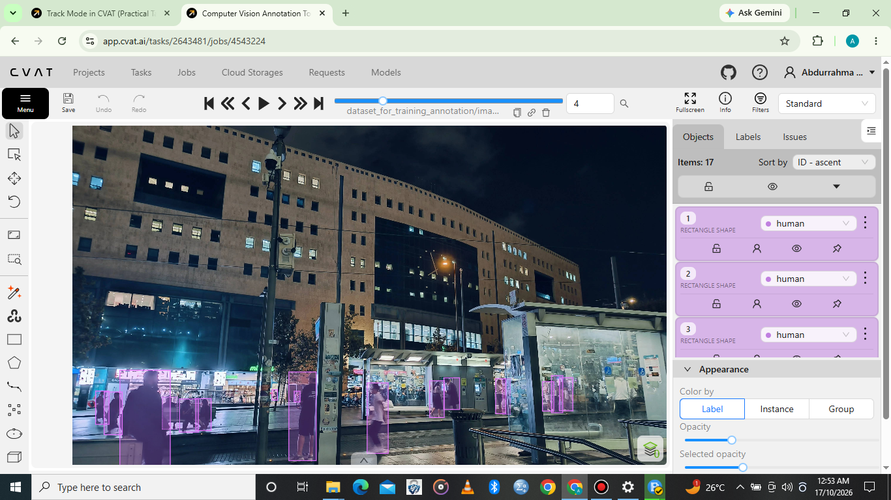

# 2D Bounding Box Annotation Using CVAT

## Project Overview

This project demonstrates my practical skills in 2D bounding box annotation using CVAT (Computer Vision Annotation Tool).

The project includes annotating two object classes: **cars and people**. The screenshots showcase bounding boxes drawn around cars, while the demonstration video presents the annotation of people in images.

For both examples, bounding boxes are placed around visible objects and assigned the appropriate labels. The annotations are reviewed to ensure that the boxes align as closely as possible with the target objects.

## Tools Used

- **Annotation Tool:** CVAT
- **Annotation Type:** 2D Bounding Box Annotation
- **Object Classes:** Car and Person

## Skills Demonstrated

- Object identification and localization
- Bounding box placement and adjustment
- Object labeling and class consistency
- Attention to detail
- Annotation review and quality control

## Annotation Screenshots

The following screenshots showcase my bounding box annotation work on cars, including object localization, bounding box placement, and the completed annotations.

### Screenshot 1: Car Annotation

### Screenshot 2: Additional Car Annotations

.png)

### Screenshot 3: Completed Annotation View

.png)

## Demonstration Video

The video demonstrates my bounding box annotation workflow using images of people in CVAT.

**YouTube:** [Watch the Bounding Box Annotation Demonstration](ADD_YOUR_YOUTUBE_LINK_HERE)

## Project Outcome

This project demonstrates my ability to annotate different object classes using 2D bounding boxes, apply appropriate labels, and review annotations for accuracy and consistency.

It forms part of my AI Data Annotation Portfolio and showcases my practical experience with image annotation workflows using CVAT.
readme.md
