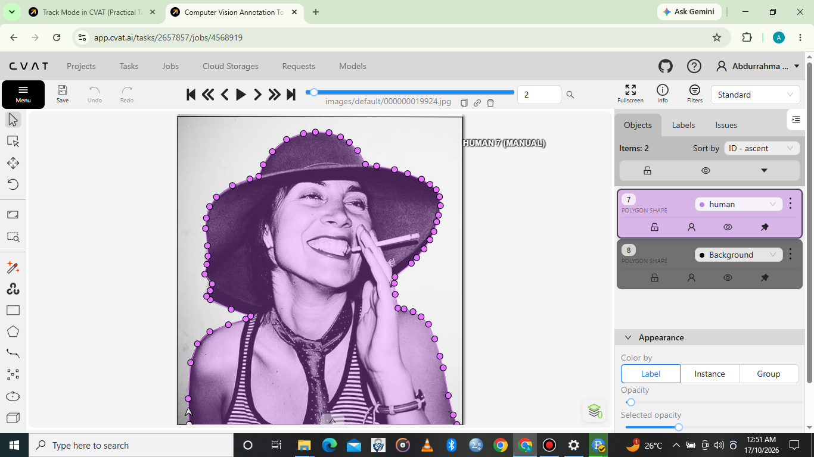

# 2D Polygon Annotation Using CVAT

## Project Overview

This project demonstrates my practical skills in 2D polygon annotation using CVAT (Computer Vision Annotation Tool).

The task involved annotating a person in an image by placing polygon points along the visible outline of the human figure. This technique helps define an object's shape and boundaries more precisely than a rectangular bounding box.

The completed annotation was reviewed to ensure that the polygon followed the visible outline of the person as accurately as possible.

## Tools Used

- **Annotation Tool:** CVAT
- **Annotation Type:** 2D Polygon Annotation
- **Object Class:** Person

## Skills Demonstrated

- Polygon annotation
- Object boundary identification
- Precise contour tracing
- Object labeling
- Attention to detail
- Annotation review and quality control

## Annotation Screenshot

The screenshot below showcases my completed polygon annotation of a person using CVAT.

## Demonstration Video

Watch my demonstration of the 2D polygon annotation workflow using CVAT.

**YouTube:** [Watch the Polygon Annotation Demonstration](https://youtu.be/r8BhZKiTnpc)

## Project Outcome

This project demonstrates my ability to trace object boundaries, create polygon annotations, apply appropriate labels, and review annotations for accuracy.

It forms part of my AI Data Annotation Portfolio and showcases my practical experience with 2D image annotation using CVAT.
readme.md
