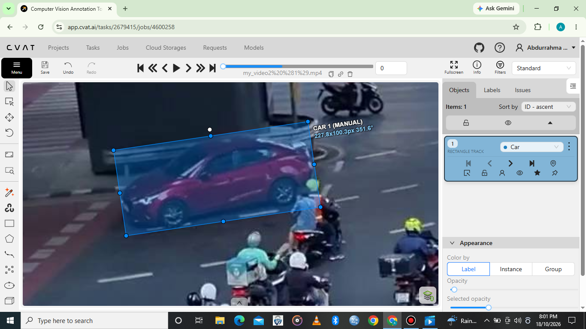
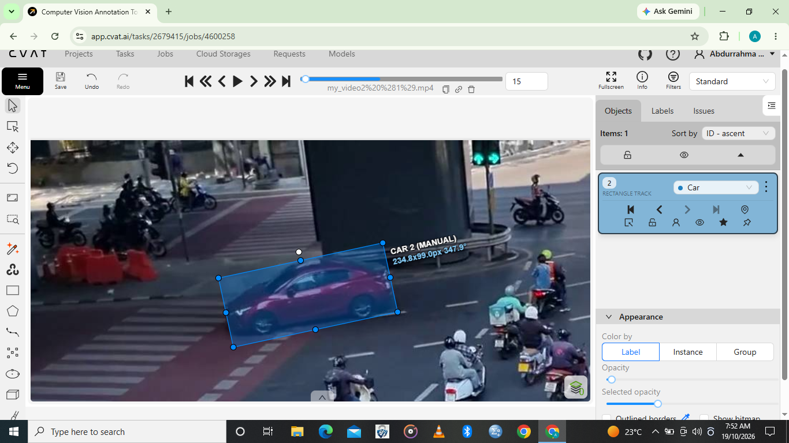
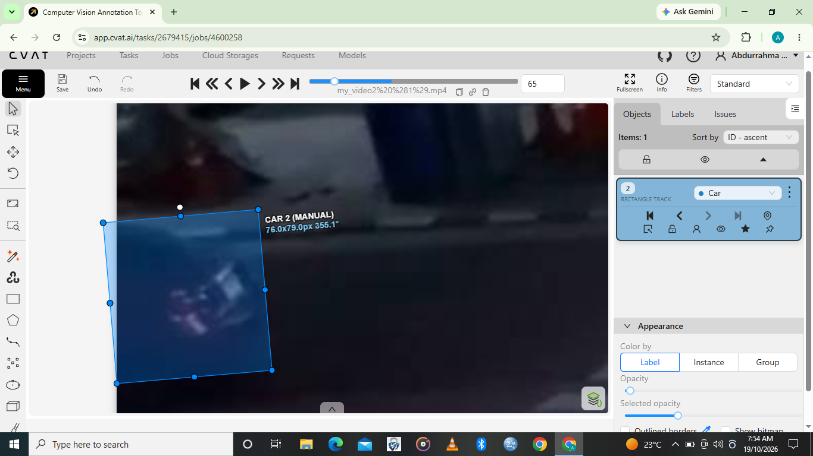

# 2D Video Object Tracking Using CVAT

## Project Overview

This project demonstrates my practical skills in 2D video object tracking using CVAT (Computer Vision Annotation Tool).

The task involves tracking a moving car across multiple video frames while maintaining a consistent object identity. Bounding boxes are placed and adjusted to follow the car's movement throughout the video sequence.

This project showcases key video annotation concepts, including tracking consistency, keyframe placement, interpolation, and handling objects that move out of view.

## Tools Used

- **Annotation Tool:** CVAT
- **Annotation Type:** 2D Video Object Tracking
- **Object Class:** Car

## Skills Demonstrated

- Video frame annotation
- Tracking moving objects across multiple frames
- Bounding box placement and adjustment
- Maintaining consistent object identity and track IDs
- Keyframe annotation and interpolation
- Handling objects that leave the video frame
- Annotation review and quality control

## Annotation Screenshots

The following screenshots showcase my video object tracking work in CVAT.

### Screenshot 1: Initial Car Tracking

Shows the car annotation across video frames, demonstrating how the object's position is tracked as it moves through the scene.

### Screenshot 2: Car Tracking Progress

Demonstrates interpolation in CVAT, where object positions between keyframes are automatically estimated to support efficient video annotation.

### Screenshot 3: Continued Car Tracking

Shows the use of the “Outside” attribute to indicate when the car is no longer visible in the video frame.

## Demonstration Video

Watch my demonstration of 2D video object tracking using CVAT.

**YouTube:** [Watch the Video Object Tracking Demonstration](https://youtu.be/mb8sHY4hPtg)

## Project Outcome

This project demonstrates my understanding of video annotation workflows, bounding box tracking, consistent object identification, and keyframe-based annotation. It highlights practical skills relevant to preparing video datasets for computer vision and AI model training.

This project forms part of my AI Data Annotation Portfolio.

