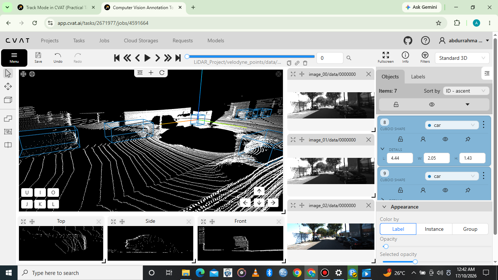
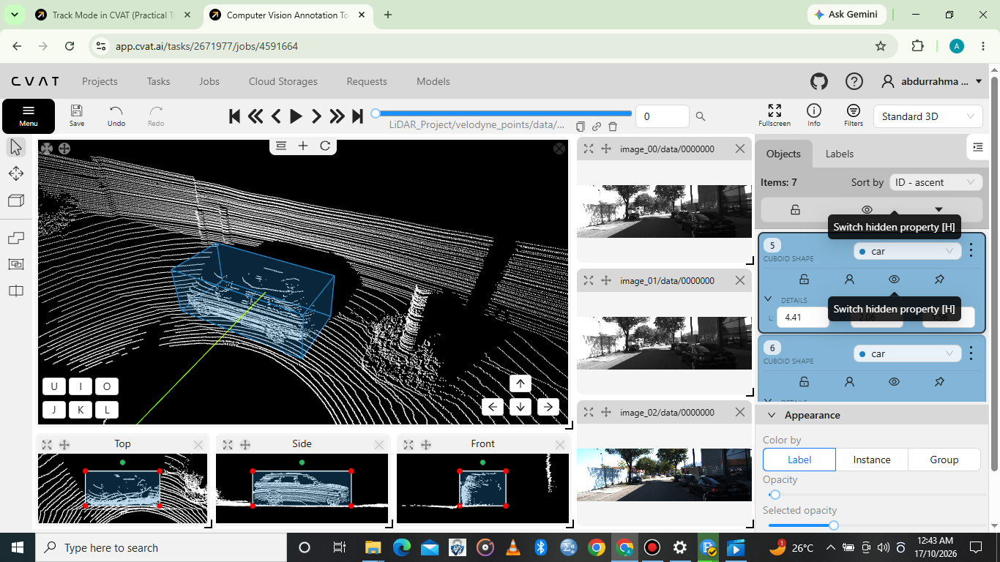
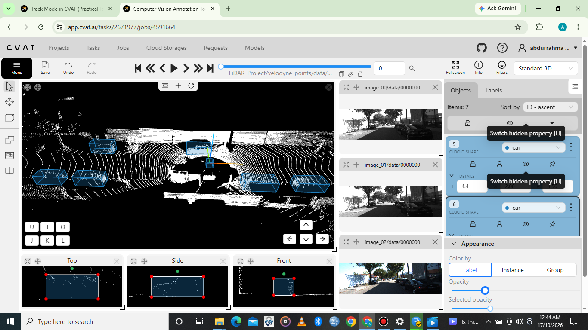

# 3D Cuboid Annotation Using CVAT

## Project Overview

This project demonstrates my practical skills in 3D cuboid annotation using CVAT (Computer Vision Annotation Tool).

The task involved annotating cars in a 3D scene by placing and adjusting cuboids to represent their spatial positions, dimensions, and orientations.

3D cuboid annotation helps represent objects in three-dimensional space and is useful for preparing datasets for computer vision applications, including autonomous driving and scene understanding.

## Tools Used

- **Annotation Tool:** CVAT
- **Annotation Type:** 3D Cuboid Annotation
- **Object Class:** Car

## Skills Demonstrated

- 3D cuboid annotation
- Car identification and localization
- 3D bounding box placement and adjustment
- Object dimensions and orientation
- Spatial awareness
- Annotation review and quality control

## Annotation Screenshots

The following screenshots showcase my 3D cuboid annotation work in CVAT.

### Screenshot 1: Car 3D Cuboid Annotation

Shows a 3D cuboid placed around a car to represent its position and dimensions within the scene.

### Screenshot 2: Car Cuboid Positioning

Shows the placement and adjustment of a 3D cuboid around a car.

### Screenshot 3: 3D Scene Overview

Provides an overview of the annotated 3D scene and the car cuboid annotation.

## Demonstration Video

Watch my demonstration of 3D cuboid annotation for cars using CVAT.

**YouTube:** [Watch the 3D Cuboid Annotation Demonstration](https://youtu.be/GyQi2mmJ8h4)

## Project Outcome

This project demonstrates my ability to identify cars in a 3D scene, place and adjust cuboids, and represent object positions and dimensions for computer vision annotation tasks.

This project forms part of my AI Data Annotation Portfolio and showcases my practical experience with 3D annotation using CVAT.readme.md
